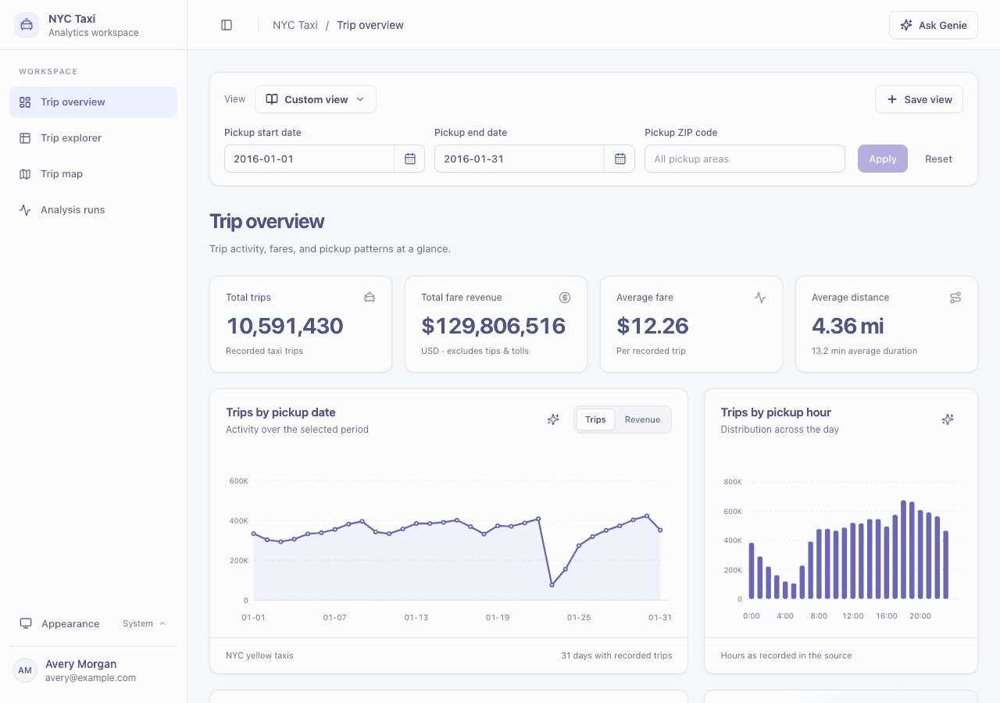

# Effective Analytics Workbench

This TypeScript example for Databricks Apps uses Effect and Foldkit. Explore
historical NYC taxi trips with Databricks SQL, ask Genie about the current view,
save shared work in Lakebase, and run a Databricks job.

This project is independently maintained and is not affiliated with or endorsed by Databricks, Inc.

[Deploy the example](DEPLOYMENT.md) ·
[Use your own data](#use-your-own-data) ·
[Integration patterns](docs/integration.md) ·
[Reuse the SQL adapter](packages/sql-warehouse/README.md)

The walkthrough uses real January 2016 yellow taxi records with fictional
names and a sample comment. ZIP codes are approximated from taxi zones.
[NYC Taxi and Limousine Commission trip data](https://www.nyc.gov/site/tlc/about/tlc-trip-record-data.page)

## What the example does

- **Databricks SQL** shows up to 10,000 sorted, filtered trips in **Trip explorer**.
  It also computes the overview charts and the busiest H3 cells on the map.
- **Genie** answers questions using the active filters and explains selected
  charts or map areas. The app displays answers, result tables, and generated SQL.
- **Lakebase** stores saved filters, findings, and comments on trip records.
- **Databricks Jobs** runs a SQL task to compare 90th-percentile trip times by
  pickup ZIP, drop-off ZIP, and time of day.

Effect manages server services and their lifetimes. The server and the Foldkit
client share the same HTTP contract and runtime schemas. [HTTP contract](packages/shared/src/api.ts)

## Run an analysis

In **Analysis runs**, select **New run**. Choose the start dates for two
seven-day windows and set the minimum trips per route in each window. Select
**Run analysis**. Open completed reports from **Recent runs** or the run link.

## Use your own data

Set up the example and run it locally with your Databricks CLI login.
[Set up a target](DEPLOYMENT.md#set-up-a-target) · [Develop locally](DEPLOYMENT.md#develop-locally)

| Replace                       | Start here                                                                                        |
| ----------------------------- | ------------------------------------------------------------------------------------------------- |
| Sample data and queries       | [Seed job](jobs/seed-trip-snapshot.sql) and [analytics service](server/src/taxi/analytics.ts)     |
| API and data types            | [Shared HTTP contract](packages/shared/src/api.ts) and [schemas by feature](packages/shared/src/) |
| Filters and views             | [Foldkit features](client/src/features)                                                           |
| Genie tables and instructions | [Genie resource](resources/genie.yml)                                                             |
| Route analysis                | [Route reliability SQL](jobs/route-reliability.sql)                                               |
| Workspace resources           | [Databricks bundle](databricks.yml)                                                               |

The deployed app uses its service principal for data access. Saved views and
comments are shared across viewers. If your users have different permissions,
enforce record access in the API handlers. [API handlers](server/src/routes.ts)

Run `npm run check` to verify a change. [Browser and deployment checks](DEPLOYMENT.md#verify-the-app)

[Taxi data and asset sources](client/public/SOURCES.md)
